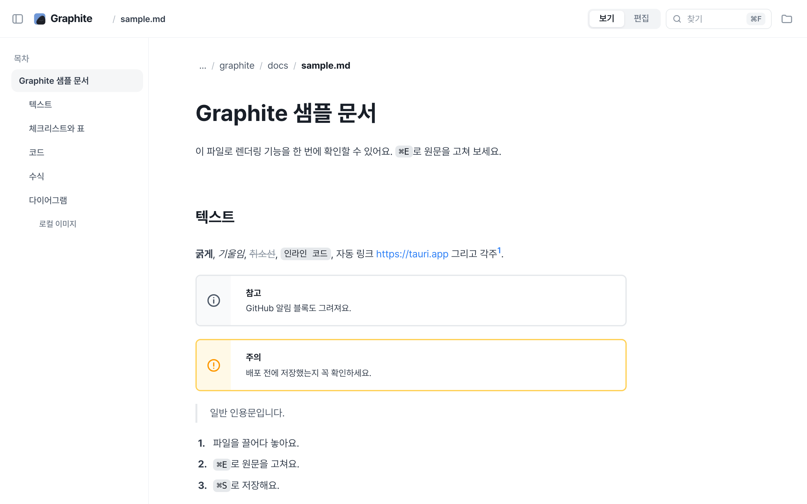

<p align="center">
  
</p>

<h1 align="center">Graphite</h1>

Graphite는 macOS에서 마크다운 파일을 읽는 앱입니다. 기본 앱으로 지정해 두면 Finder에서 `.md` 파일을 더블클릭해 바로 읽을 수 있습니다. 오타나 숫자 하나를 고칠 때는 `⌘E`를 눌러 오른쪽에 원문을 띄우고, `⌘S`로 같은 파일에 저장합니다.


강의 정리나 실습 기록을 다시 볼 때마다 에디터를 열고 미리보기를 켜는 게 번거로웠습니다. 문서 옆 폴더에 둔 이미지나 본문에 적어 둔 수식까지 한 화면에서 보고 싶어서 만들었습니다.

## 설치

macOS에서 소스를 내려받아 빌드합니다. Node.js, Rust, Xcode Command Line Tools가 필요합니다.

```bash
git clone https://github.com/aghoc/graphite.git
cd graphite
npm install
npm run build
cp -R src-tauri/target/release/bundle/macos/Graphite.app /Applications/
```

Finder에서 마크다운 파일을 더블클릭할 때 Graphite가 열리도록 하려면 아래 명령을 실행하세요. macOS 12 이상에서 `.md`, `.markdown`, `.mdown`, `.mkd`, `.mkdn`의 기본 앱을 바꿉니다. 다른 앱으로 되돌릴 때는 명령 뒤에 해당 앱의 경로를 붙이면 됩니다.

```bash
swift scripts/set-default-viewer.swift
```

코드를 업데이트한 뒤에는 `npm run update`로 설치한 앱을 교체할 수 있습니다. Graphite가 켜져 있다면 종료한 뒤 다시 열면 됩니다.

## 사용법

- **파일 열기** — `⌘O`를 누르거나 파일을 창에 끌어다 놓습니다. 폴더째 보려면 `⇧⌘O`로 열고 왼쪽 **파일** 탭에서 문서를 고릅니다. `⌘N`으로 새 마크다운 파일을 만들 수 있습니다.
- **문서 읽기** — 왼쪽 목차에서 제목을 고르면 해당 위치로 이동합니다. `⌘F`로 본문을 찾고, `⌘+`와 `⌘-`로 글자 크기를 바꿀 수 있습니다. `⌘0`을 누르면 기본 크기로 돌아갑니다.
- **원문 고치기** — `⌘E`로 편집기를 열면 입력한 내용이 왼쪽 화면에 바로 반영됩니다. 두 화면이 함께 스크롤되고, 가운데 경계선을 끌어 너비를 조절할 수 있습니다.
- **다른 앱에서 수정한 파일 다시 보기** — 같은 파일을 다른 앱에서 저장하면 Graphite가 다시 읽습니다. 편집기를 열어 둔 상태라면 새로 불러올지 먼저 묻습니다.

표, 체크리스트, 각주, 알림 블록, 코드 강조, KaTeX 수식과 Mermaid 다이어그램을 표시합니다. 이미지의 상대 경로는 마크다운 파일 위치를 기준으로 읽습니다. 로컬 파일을 열고 렌더링하는 데 인터넷 연결은 필요 없습니다. 예제는 [docs/sample.md](docs/sample.md)에서 볼 수 있습니다.

| 읽기 화면 | 원문 편집을 열었을 때 |
| --- | --- |
|  |  |

시스템이 다크 모드면 앱도 어두운 색으로 표시됩니다. 위 GIF는 사용 흐름을 보여 주기 위해 재현한 데모입니다. [다크 모드 화면](docs/images/viewer-dark.png) · [데모 소스](docs/demo)

## 개발

Tauri v2의 웹뷰에 HTML, CSS, JavaScript로 화면을 그립니다. Rust 쪽에서 파일을 열고 저장하며, comrak으로 마크다운을 렌더링합니다. 수식, 다이어그램 렌더러와 글꼴은 앱에 포함됩니다.

```bash
npm run dev
npm run dev:sample
npm run dev -- -- -- "경로/문서.md"
```

렌더링과 파일 탐색기 테스트는 `src-tauri`에서 실행합니다.

```bash
cd src-tauri
cargo test
```

화면 코드는 [src/](src), 파일 처리와 마크다운 렌더링은 [src-tauri/src/lib.rs](src-tauri/src/lib.rs)에 있습니다.

## 라이선스

Graphite 코드는 [MIT 라이선스](LICENSE)를 따릅니다.

| 라이브러리·글꼴 | 용도 | 라이선스 |
| --- | --- | --- |
| [Tauri](https://tauri.app) | 데스크톱 앱 프레임워크 | MIT / Apache-2.0 |
| [comrak](https://github.com/kivikakk/comrak) | 마크다운 렌더링 | BSD-2-Clause |
| [notify](https://github.com/notify-rs/notify) | 파일 변경 감지 | CC0-1.0 |
| [KaTeX](https://katex.org) | 수식 렌더링 | MIT |
| [Mermaid](https://mermaid.js.org) | 다이어그램 렌더링 | MIT |
| [highlight.js](https://highlightjs.org) | 코드 강조 | BSD-3-Clause |
| [Pretendard](https://github.com/orioncactus/pretendard) | 본문 글꼴 | SIL OFL 1.1 |
| [토스페이스](https://github.com/toss/tossface) v1.6.1 | 이모지 글꼴 | [토스페이스 라이선스](licenses/tossface/LICENSE) |

본문과 목차에는 토스팀에서 제공한 토스페이스를 사용합니다. Graphite는 공식 v1.6.1의 WOFF2 파일을 그대로 넣습니다. 토스페이스를 재배포할 때는 저작권 안내와 라이선스 전문을 함께 넣어야 하며, 글꼴 자체를 판매하거나 허락 없이 수정본을 만들 수 없습니다. Graphite는 빌드할 때 두 문서를 앱에 포함합니다. [저작권 안내](licenses/tossface/NOTICE.md) · [라이선스 전문](licenses/tossface/LICENSE)
