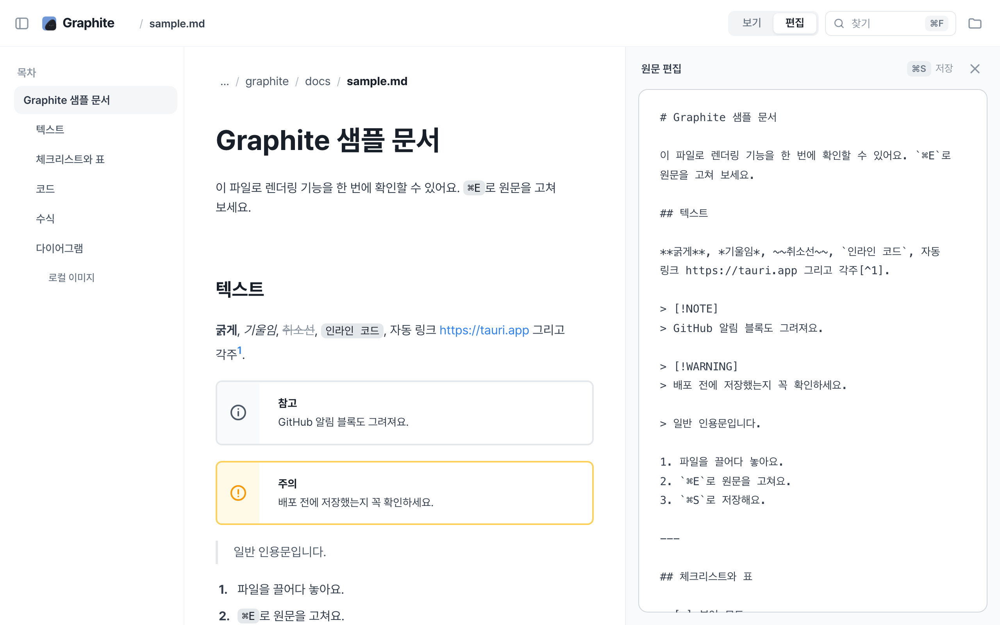

<p align="center">
  
</p>

<h1 align="center">Graphite</h1>

<p align="center">
  <code>.md</code> 파일을 더블클릭하면 읽기 화면으로 바로 열리는 macOS용 마크다운 뷰어입니다.<br>
  고칠 때만 <code>⌘E</code>로 옆에 원문 편집기를 엽니다.
</p>

<p align="center">Tauri v2 · Rust · 설치본 10MB · 인터넷 연결 없이 동작</p>


## 왜 만들었나

마크다운 파일은 쓸 때보다 읽을 때가 많습니다. 강의 정리본, 실습 기록, AI가 만들어 준 보고서를 열어 보고, 가끔 오타나 숫자 하나를 고칩니다.

그런데 Finder에서 `.md`를 더블클릭하면 VS Code가 작업 공간째로 뜨거나, MarkText가 편집 화면으로 열렸습니다. 편집 화면에서는 읽다가 키를 잘못 누르면 내용이 그대로 바뀝니다. 수식·다이어그램·문서 옆 이미지가 섞인 문서를 한 번에 보여 주는 가벼운 뷰어는 찾지 못했습니다.

그래서 Graphite는 이렇게 동작합니다.

1. 더블클릭하면 읽기 화면으로 바로 열립니다. 개발한 Mac에서 재 보니 더블클릭부터 앱이 실행되기까지 0.13초 걸렸습니다.
2. 읽는 동안에는 문서가 바뀌지 않습니다.
3. `⌘E`를 누르면 오른쪽에 원문 편집기가 열리고, 입력한 내용이 왼쪽 화면에 바로 반영됩니다.
4. 다른 에디터에서 파일을 고치면 화면을 다시 그립니다. 편집 중일 때는 덮어쓰지 않고 먼저 묻습니다.

## 다른 도구와 비교

아래 도구는 각자 잘하는 일이 있습니다. Graphite는 "열어서 읽고, 가끔 고치는" 일에만 맞췄습니다.

| 도구 | 잘하는 일 | 읽기용으로 쓸 때 걸리는 점 |
|---|---|---|
| VS Code | 코드와 문서를 함께 다루는 작업 | 에디터 전체가 뜨고, 미리보기는 따로 열어야 합니다 |
| MarkText | 화면에 보이는 그대로 편집(WYSIWYG), 오픈소스 | 처음부터 편집 상태로 열립니다 |
| Typora | 화면에 보이는 그대로 편집(WYSIWYG) | 유료이고, 편집 중심입니다 |
| Obsidian | 노트끼리 연결하고 관리하기 | 보관함(vault) 단위로 써서, 파일 하나만 열어 보기에는 무겁습니다 |
| macOS 훑어보기(Quick Look) | 스페이스바로 바로 보기 | 고칠 수 없고, 수식·다이어그램·목차가 없습니다 |

## 만든 방식

- 화면은 읽기용으로만 그리고, 고칠 때는 원문을 직접 고칩니다. 보이는 그대로 편집하는 방식은 엔진이 무겁고 저장할 때 원문 서식을 바꾸기도 해서 쓰지 않았습니다.
- Electron 대신 Tauri를 썼습니다. 브라우저를 앱에 넣지 않고 macOS의 웹뷰를 써서 설치본이 10MB입니다.
- 마크다운은 Rust 라이브러리 [comrak](https://github.com/kivikakk/comrak)으로 해석합니다. 화면 코드는 번들러 없이 HTML·CSS·JS로 썼습니다.
- 수식·다이어그램·글꼴을 앱 안에 넣어 인터넷 없이 동작합니다. 문서 안의 스크립트는 실행하지 않습니다.

## 기능

- 열기: 터미널 인자, Finder 더블클릭, 창에 끌어다 놓기, `⌘O`
- 렌더링: GitHub식 마크다운(GFM)의 표·체크리스트·취소선·각주·자동 링크, `> [!NOTE]` 알림 블록, 코드 강조, 수식(`$…$`·`$$…$$`), Mermaid 다이어그램, 문서 기준 상대 경로 이미지
- 나란히 편집: `⌘E`를 누르면 오른쪽에 원문 편집기가 열립니다. 두 창은 원문 줄 기준으로 함께 스크롤되어, 긴 코드 블록을 지나도 위치가 어긋나지 않습니다. 가운데 막대를 끌면 폭이 바뀝니다.
- 저장: `⌘S`로 원본 파일에 덮어씁니다. 저장하지 않은 변경이 있으면 "수정됨" 표시와 창 제목의 `*`로 알려 주고, 창을 닫을 때 한 번 묻습니다. Windows식 줄바꿈(CRLF)으로 된 파일은 그대로 유지합니다.
- 파일 감시: 다른 곳에서 파일이 바뀌면 스크롤 위치를 지킨 채 다시 그립니다. 편집 중이면 "새로 불러오기"와 "이대로 두기" 중에 고르게 합니다.
- 목차와 찾기: H1~H3 제목으로 목차를 만듭니다(`⌘\`로 접기). `⌘F`로 문서 안을 찾습니다.
- 보기 설정: 시스템 다크 모드를 따르고, `⌘+`·`⌘-`·`⌘0`으로 글자 크기를 바꿉니다.

## 화면

| 읽기 | 나란히 편집 |
|---|---|
|  |  |


스크린샷은 앱의 화면 코드로 [docs/sample.md](docs/sample.md)를 그려 찍었습니다. 맨 위 애니메이션은 실제 녹화가 아니라 화면을 단순화해 다시 그린 데모입니다([docs/demo](docs/demo)).

## 설치 (macOS)

필요한 것: Node.js, Rust, Xcode Command Line Tools

```bash
npm install                                     # 빌드 도구 설치 + 렌더링 라이브러리를 src/vendor로 복사
npm run build                                   # src-tauri/target/release/bundle/ 에 .app과 .dmg 생성
cp -R src-tauri/target/release/bundle/macos/Graphite.app /Applications/
swift scripts/set-default-viewer.swift          # .md .markdown .mdown .mkd .mkdn 을 Graphite로 열기
```

`set-default-viewer.swift`는 Finder의 "정보 가져오기 → 다음으로 열기 → 모두 변경"과 같은 일을 합니다. 원래 앱으로 되돌리려면 그 앱의 경로를 넘기면 됩니다.

```bash
swift scripts/set-default-viewer.swift "/Applications/Visual Studio Code.app"
```

서명하지 않은 앱이라, 다른 Mac에서 `.dmg`로 설치하면 "확인되지 않은 개발자" 경고가 뜹니다. 앱을 오른쪽 클릭하고 "열기"를 한 번 누르면 그다음부터는 그냥 열립니다.

Windows·Linux용 빌드(`.msi`/`.exe`, `.deb`/`.AppImage`)도 만들 수 있지만, 직접 실행해 보지는 않았습니다.

### 업데이트

코드를 고친 뒤 아래 명령을 실행하면 `/Applications/Graphite.app`이 새 버전으로 바뀝니다. 기본 앱 지정은 그대로 남습니다. 켜져 있는 앱은 끄지 않으니, 창을 닫고 다시 열면 새 버전으로 뜹니다.

```bash
npm run update
```

## 단축키 (Windows/Linux는 ⌘ 대신 Ctrl)

| 동작 | 키 |
|---|---|
| 파일 열기 | ⌘O |
| 보기 ↔ 나란히 편집 | ⌘E |
| 저장 | ⌘S |
| 찾기 / 다음 / 이전 / 닫기 | ⌘F / Enter / Shift+Enter / Esc |
| 목차 접기·펼치기 | ⌘\ |
| 글자 크기 | ⌘+ / ⌘- / ⌘0 |

## 개발

```bash
npm run dev                   # 개발 실행 (빈 안내 화면부터)
npm run dev:sample            # docs/sample.md를 바로 열어서 실행
npm run dev -- -- -- 경로.md   # 원하는 파일로 실행 (npm이 -- 하나를 먹으므로 세 개)
```

개발 실행 중에는 렌더링 결과와 화면 오류가 터미널에 찍힙니다. 개발자 도구는 창에서 오른쪽 클릭 → "요소 검사"로 엽니다.

```
[web] 렌더 완료: sample.md | 제목 7개, 수식 2개, 다이어그램 1개, 이미지 1/1개 표시
```

아이콘을 바꾸려면 `docs/assets/logo.png`를 정사각형 이미지로 바꾸고 `npm run icon`을 실행하면 됩니다. macOS 규격에 맞게 둥근 모서리와 여백을 입힌 `app-icon.png`를 만들고, 이걸로 모든 플랫폼의 아이콘을 다시 만듭니다.

### 구조

```
src/                    프론트엔드 (번들러 없음)
  index.html  main.js   화면, 렌더링 후처리, 목차, 찾기, 편집, 스크롤 동기화
  ui.css                디자인 토큰과 기본 부품
  style.css             앱 전용 규칙
  vendor/               npm install 때 자동 생성 (git 제외)
src-tauri/
  src/lib.rs            실행 인자, 파일 열기·저장, comrak 렌더링, notify 파일 감시
  tauri.conf.json       창, CSP, 로컬 이미지 프로토콜, 파일 연결
  capabilities/         프론트엔드 권한
scripts/                vendor 복사, 아이콘 생성, 업데이트, 기본 앱 지정
docs/sample.md          기능 확인용 문서
docs/images/            README 스크린샷과 데모 GIF
docs/demo/              데모 GIF를 만든 장면과 녹화 스크립트
```

### 테스트

```bash
cd src-tauri && cargo test                                         # 렌더링 테스트
cd src-tauri && cargo test -- --ignored dump_sample --nocapture    # sample.md 렌더 결과 출력
```

## 함께 쓰는 오픈소스

| 이름 | 용도 | 라이선스 |
|---|---|---|
| [Tauri](https://tauri.app) | 앱 틀 | MIT / Apache-2.0 |
| [comrak](https://github.com/kivikakk/comrak) | 마크다운 해석 | BSD-2-Clause |
| [notify](https://github.com/notify-rs/notify) | 파일 감시 | CC0-1.0 |
| [KaTeX](https://katex.org) | 수식 | MIT |
| [Mermaid](https://mermaid.js.org) | 다이어그램 | MIT |
| [highlight.js](https://highlightjs.org) | 코드 강조 | BSD-3-Clause |
| [Pretendard](https://github.com/orioncactus/pretendard) | 글꼴 | SIL OFL 1.1 |

## 라이선스

[MIT](LICENSE)
