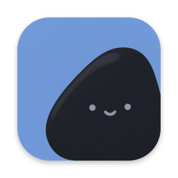
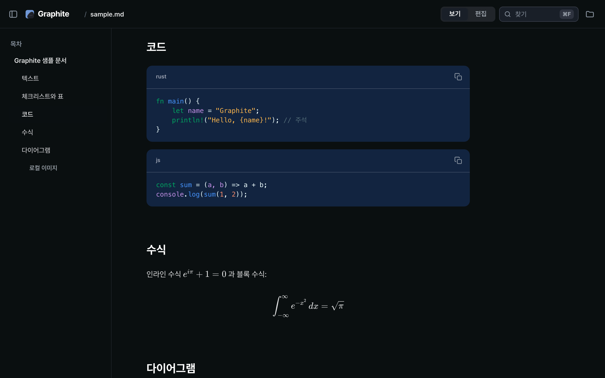

<p align="center">
  
</p>

<h1 align="center">Graphite</h1>

<p align="center">
  <code>.md</code> 파일을 더블클릭하면 바로 열려서 깔끔하게 읽히는 macOS용 마크다운 뷰어.<br>
  필요할 때만 <code>⌘E</code>로 원문을 고친다.
</p>

<p align="center">Tauri v2 · Rust · 설치본 약 10MB · 오프라인</p>


## 왜 만들었나

마크다운 파일을 **쓰는** 일보다 **읽는** 일이 훨씬 많다. 강의 정리본, 실습 진행 기록, AI가 만들어 준 보고서처럼 이미 다 쓰인 문서를 열어 보고, 가끔 오타 한 줄이나 숫자 하나를 고친다.

그런데 Finder에서 `.md`를 더블클릭하면 매번 같은 불편이 있었다.

- **VS Code**로 열면 에디터와 사이드바가 먼저 뜨고, 미리보기는 따로 열어야 한다. 읽기만 하려는데 작업 공간이 통째로 뜬다.
- **MarkText**로 열면 처음부터 편집 화면이다. 문서를 훑다가 키를 잘못 누르면 그대로 내용이 바뀐다.
- 수식(KaTeX)과 다이어그램(Mermaid), 문서 옆 폴더의 이미지가 섞인 문서를 한 번에 제대로 보여 주는 가벼운 도구를 찾기 어려웠다.

그래서 기준을 이렇게 잡았다.

1. 더블클릭하면 0.1초 안에 열린다.
2. 기본은 읽기 전용 뷰어다. 실수로 문서가 바뀌지 않는다.
3. 고칠 때만 `⌘E`로 원문 편집기를 옆에 연다. 뷰어는 그대로 두고 실시간으로 갱신한다.
4. 다른 에디터에서 파일을 고치면 알아서 다시 그린다. 단, 내가 편집 중일 때는 덮어쓰지 않는다.

## 기존 도구와 무엇이 다른가

좋은 도구는 이미 많다. Graphite는 그중 어느 것을 대신하려는 게 아니라, "**열어서 읽고, 가끔 고친다**"는 한 가지 쓰임에 맞췄다.

| 도구 | 잘하는 것 | 이 쓰임에서 아쉬운 점 |
|---|---|---|
| VS Code | 코드와 문서를 함께 다루는 작업 | 문서 하나 읽으려고 에디터 전체가 뜨고, 미리보기는 따로 열어야 한다 |
| MarkText | 오픈소스 WYSIWYG 편집 | 편집기가 기본 화면이라 읽기만 할 때도 편집 상태다 |
| Typora | 매끄러운 WYSIWYG 편집 | 유료이고, 역시 편집 중심이다 |
| Obsidian | 노트끼리 연결하고 관리하기 | 보관함(vault) 단위로 쓰는 도구라 낱개 파일을 열어 보기에는 무겁다 |
| macOS 훑어보기(Quick Look) | 스페이스바로 바로 보기 | 고칠 수 없고, 수식·다이어그램·목차가 없다 |

Graphite가 고른 방식:

- **WYSIWYG 대신 "뷰어 + 원문 편집기".** 실시간 WYSIWYG 엔진은 무겁고 원문을 바꿔 버리기도 한다. 화면은 읽기용으로 그리고, 고칠 때는 원문을 그대로 고친다.
- **Electron 대신 Tauri.** 브라우저를 앱에 통째로 넣지 않고 운영체제의 웹뷰를 써서 설치본이 작고 빨리 뜬다.
- **렌더링은 Rust에서.** 마크다운 해석은 [comrak](https://github.com/kivikakk/comrak)이 하고, 프론트엔드는 번들러 없는 순수 HTML·CSS·JS다.
- **오프라인.** 수식·다이어그램·글꼴을 모두 앱 안에 넣었다. 문서 안의 스크립트는 실행되지 않는다.

## 기능

- **바로 열기**: 실행 인자, Finder 더블클릭(파일 연결), 끌어다 놓기, `⌘O`
- **렌더링**: GFM(표·체크리스트·취소선·각주·자동 링크), `> [!NOTE]` 알림 블록, 코드 강조(highlight.js), 수식(KaTeX, `$…$`·`$$…$$`), 다이어그램(Mermaid), 문서 기준 상대 경로 이미지
- **나란히 편집**: `⌘E`를 누르면 오른쪽에 원문 편집기가 열린다. 입력하면 왼쪽 뷰어가 바로 바뀌고, 두 창은 원문 줄 기준으로 함께 스크롤된다(긴 코드 블록이 있어도 어긋나지 않는다). 가운데 막대로 폭을 조절한다.
- **저장**: `⌘S`로 원본 파일에 덮어쓴다. 저장하지 않은 변경은 "수정됨" 표시와 창 제목의 `*`로 알려 주고, 창을 닫을 때 한 번 묻는다. 원래 CRLF 줄바꿈이던 파일은 그대로 유지한다.
- **파일 감시**: 다른 곳에서 파일이 바뀌면 스크롤 위치를 지킨 채 다시 그린다. 편집 중이면 덮어쓰지 않고 "새로 불러오기 / 이대로 두기"를 묻는다.
- **목차와 찾기**: H1~H3로 만든 목차(`⌘\`로 접기), 문서 안 찾기(`⌘F`, `Enter`/`Shift+Enter`, `Esc`)
- **보기 설정**: 시스템 다크 모드 연동, 글자 크기 `⌘+`/`⌘-`/`⌘0`

## 화면

| 읽기 | 나란히 편집 |
|---|---|
|  |  |



스크린샷은 앱의 프론트엔드를 [docs/sample.md](docs/sample.md)로 렌더링해 찍었다. 맨 위 애니메이션은 화면을 단순화해 다시 그린 소개용 데모다([docs/demo](docs/demo)).

## 설치 (macOS)

필요한 것: Node.js, Rust, Xcode Command Line Tools

```bash
npm install                                     # 빌드 도구 설치 + 렌더링 라이브러리를 src/vendor로 복사
npm run build                                   # src-tauri/target/release/bundle/ 에 .app과 .dmg 생성
cp -R src-tauri/target/release/bundle/macos/Graphite.app /Applications/
swift scripts/set-default-viewer.swift          # .md .markdown .mdown .mkd .mkdn 을 Graphite로 열기
```

`set-default-viewer.swift`는 Finder의 "정보 가져오기 → 다음으로 열기 → 모두 변경"과 같은 일을 한다. 되돌리려면 원래 앱 경로를 넘긴다.

```bash
swift scripts/set-default-viewer.swift "/Applications/Visual Studio Code.app"
```

서명하지 않은 앱이라 직접 빌드하지 않은 `.dmg`를 다른 Mac에서 열면 "확인되지 않은 개발자" 경고가 뜬다. 앱을 오른쪽 클릭 → 열기로 한 번 실행하면 된다.

Windows·Linux도 Tauri로 빌드는 되지만(`.msi`/`.exe`, `.deb`/`.AppImage`) 직접 확인하지는 않았다.

### 업데이트

코드를 고친 뒤에는 명령 하나로 설치본을 바꾼다. `.app`만 빌드해 `/Applications/Graphite.app`과 교체하고, 기본 앱 지정은 그대로 유지된다. 켜져 있는 앱은 강제로 끄지 않으니 창을 닫고 다시 열면 새 버전이 뜬다.

```bash
npm run update
```

## 단축키 (Windows/Linux는 ⌘ 대신 Ctrl)

| 동작 | 키 |
|---|---|
| 파일 열기 | ⌘O |
| 보기 ↔ 나란히 편집 | ⌘E |
| 저장 | ⌘S |
| 찾기 / 다음 / 이전 / 닫기 | ⌘F / Enter / Shift+Enter / Esc |
| 목차 접기·펼치기 | ⌘\ |
| 글자 크기 | ⌘+ / ⌘- / ⌘0 |

## 개발

```bash
npm run dev                   # 개발 실행 (빈 안내 화면부터)
npm run dev:sample            # docs/sample.md를 바로 열어서 실행
npm run dev -- -- -- 경로.md   # 원하는 파일로 실행 (npm이 -- 하나를 먹으므로 세 개)
```

개발 실행 중에는 렌더링 결과와 웹뷰 오류가 터미널에 찍힌다. 웹뷰 개발자 도구는 창에서 오른쪽 클릭 → 요소 검사.

```
[web] 렌더 완료: sample.md | 제목 7개, 수식 2개, 다이어그램 1개, 이미지 1/1개 표시
```

아이콘을 바꾸려면 `docs/assets/logo.png`(정사각형)를 교체한 뒤 `npm run icon`. `scripts/make_icon.py`가 macOS 규격의 둥근 모서리·여백을 입혀 `app-icon.png`를 만들고, 그걸로 모든 플랫폼 아이콘을 생성한다.

### 구조

```
src/                    프론트엔드 (번들러 없음)
  index.html  main.js   화면, 렌더링 후처리, 목차, 찾기, 편집, 스크롤 동기화
  ui.css                디자인 토큰과 기본 부품
  style.css             앱 전용 규칙
  vendor/               npm install 때 자동 생성 (git 제외)
src-tauri/
  src/lib.rs            실행 인자, 파일 열기·저장, comrak 렌더링, notify 파일 감시
  tauri.conf.json       창, CSP, 로컬 이미지 프로토콜, 파일 연결
  capabilities/         프론트엔드 권한
scripts/                vendor 복사, 아이콘 생성, 업데이트, 기본 앱 지정
docs/sample.md          기능 확인용 문서
docs/images/            README 스크린샷과 데모 GIF
docs/demo/              데모 GIF를 만든 장면과 녹화 스크립트
```

### 테스트

```bash
cd src-tauri && cargo test                                         # 렌더링 테스트
cd src-tauri && cargo test -- --ignored dump_sample --nocapture    # sample.md 렌더 결과 출력
```

## 함께 쓰는 오픈소스

| 이름 | 용도 | 라이선스 |
|---|---|---|
| [Tauri](https://tauri.app) | 앱 틀 | MIT / Apache-2.0 |
| [comrak](https://github.com/kivikakk/comrak) | 마크다운 해석 | BSD-2-Clause |
| [notify](https://github.com/notify-rs/notify) | 파일 감시 | CC0-1.0 |
| [KaTeX](https://katex.org) | 수식 | MIT |
| [Mermaid](https://mermaid.js.org) | 다이어그램 | MIT |
| [highlight.js](https://highlightjs.org) | 코드 강조 | BSD-3-Clause |
| [Pretendard](https://github.com/orioncactus/pretendard) | 글꼴 | SIL OFL 1.1 |

## 라이선스

[MIT](LICENSE)
